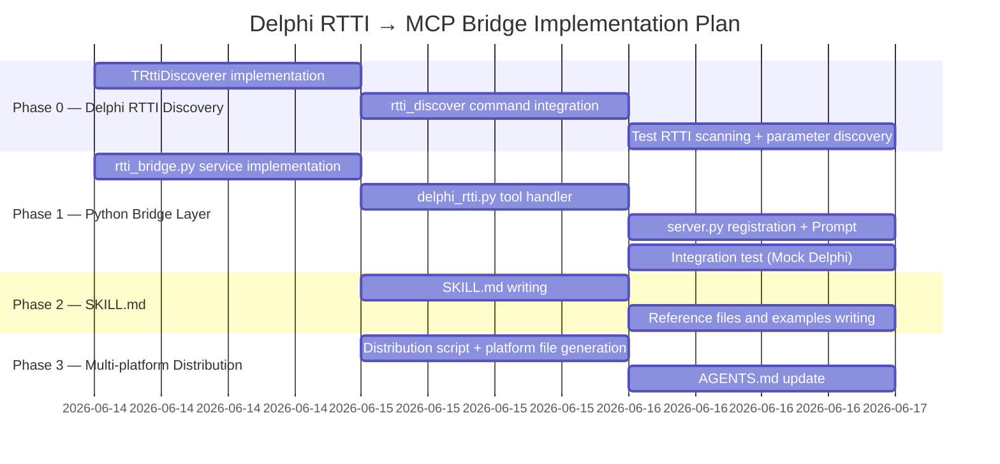

# Delphi RTTI → MCP Bridge Design Document

> **Version**: v0.1 (Draft)
> **Date**: 2026-06-13
> **Status**: Design Review

---

## Table of Contents

1. [Background and Problem](#1-background-and-problem)
2. [Agent Skills Open Standard Overview](#2-agent-skills-open-standard-overview)
3. [System Architecture](#3-system-architecture)
4. [Phase 0 — Delphi-side RTTI Discovery Protocol](#4-phase-0--delphi-side-rtti-discovery-protocol)
5. [Phase 1 — MCP Tool: delphi_rtti](#5-phase-1--mcp-tool-delphi_rtti)
6. [Phase 2 — Agent Skill: delphi-rtti-bridge](#6-phase-2--agent-skill-delphi-rtti-bridge)
7. [Phase 3 — Multi-platform Skill Distribution](#7-phase-3--multi-platform-skill-distribution)
8. [Type Mapping Table](#8-type-mapping-table)
9. [File List and Implementation Order](#9-file-list-and-implementation-order)
10. [References](#10-references)

---

## 1. Background and Problem

### 1.1 Current State

Daofy already has an automation engine (`automation_service.py`) that communicates with Delphi applications through named pipes. It already includes RTTI-based commands:

| Command | Function |
|------|------|
| `rcall` | Call published methods of Delphi objects |
| `rinspect` | Inspect the Delphi control tree |
| `rget` | Read Delphi object properties |
| `rset` | Set Delphi object properties |

But the current problem is: **AI has no way to know which capabilities a Delphi application exposes**. Every call requires the user or AI to guess method names and parameter formats.

### 1.2 Goals

Let Delphi applications self-describe their capabilities through RTTI, so AI Agents can:

1. **Discover** — know which published methods/properties a Delphi application exposes
2. **Call** — call these methods with type-correct parameters
3. **Read** — read runtime data in a structured way
4. **Zero knowledge presupposition** — AI does not need to know the Delphi-side API design in advance

### 1.3 Design Principles

- **Progressive disclosure**: load full context only when actually needed (following the Agent Skills standard)
- **Single source of truth**: maintain only one SKILL.md; other platform files are derived automatically
- **Backward compatibility**: do not break the existing `automate_delphi` tool
- **Standards first**: prioritize the MCP standard + Agent Skills open standard

---

## 2. Agent Skills Open Standard Overview

### 2.1 What are Agent Skills

Agent Skills is an open standard released by Anthropic in December 2025 ([agentskills.io](https://agentskills.io)), adopted by **30+ tools**:

- Claude Code / Claude.ai
- Cursor / Windsurf
- GitHub Copilot
- OpenAI Codex CLI
- OpenCode / OpenClaw
- Trae Solo
- Gemini CLI
- VS Code (built-in)

### 2.2 Core Concept: Progressive Disclosure

```
Level 1: YAML Frontmatter      —— always loaded (~50 tokens)
  name + description tells AI when to trigger this skill

Level 2: SKILL.md Body          —— loaded when matched (~200-500 lines)
  Complete step instructions, rules, examples

Level 3: references/ files        —— loaded on demand
  scripts/          deeper documentation, scripts, templates
  assets/
```

### 2.3 SKILL.md File Format

```markdown
---
name: skill-name
description: Concise description of the skill's function and trigger scenarios (max 1024 characters)
license: Apache-2.0                    # Optional
compatibility: claude-code, opencode   # Optional
metadata:                              # Optional
  author: daofy
  version: "1.0"
allowed-tools: Bash(*) WebFetch        # Optional, experimental
---

# Skill Name

## Overview
...

## Usage Flow
...

## Reference Files
Load `references/xxx.md` when needed
```

### 2.4 Skill Directory Structure

```
skill-name/
├── SKILL.md          # Required: metadata + instructions
├── scripts/          # Optional: executable scripts (Python/Bash/JS)
├── references/       # Optional: documents loaded on demand
├── assets/           # Optional: templates/resources/config files
└── metadata.json     # Optional: additional discovery information
```

---

## 3. System Architecture

### 3.1 Overall Architecture Diagram

```
┌──────────────────────────────────────────────────────────────────┐
│  AI Agent (Claude Code / OpenCode / Cursor / ...)               │
│                                                                  │
│  ┌────────────────────────────┐   ┌──────────────────────────┐  │
│  │ MCP Client                 │   │ Skill Engine              │  │
│  │  ├── list_tools()          │   │  ├── auto-discover        │  │
│  │  ├── call_tool()           │   │  ├── skill("delphi-...") │  │
│  │  └── get_prompt()          │   │  └── progressive load     │  │
│  └──────────┬─────────────────┘   └──────────┬────────────────┘  │
└─────────────┼─────────────────────────────────┼───────────────────┘
              │ MCP stdio                       │ SKILL.md
              ▼                                 ▼
┌──────────────────────────────────────────────────────────────────┐
│  Daofy MCP Server (Python)                                      │
│                                                                  │
│  ┌──────────────────────────────────────────────────────────┐   │
│  │ list_tools()                                              │   │
│  │  ├── delphi_rtti (1 tool, 3 actions)                  │   │
│  │  │    ├── action=guide    returns usage guide (self-describing)            │   │
│  │  │    ├── action=discover scans Delphi RTTI capabilities            │   │
│  │  │    └── action=call     calls RTTI-exposed methods             │   │
│  │  └── other existing tools (project, delphi_kb, ...)               │   │
│  │                                                           │   │
│  │ list_prompts()                                            │   │
│  │  └── delphi_rtti_guide  complete usage guide (non-OpenCode fallback)   │   │
│  └──────────────────────────────────────────────────────────┘   │
│                           │                                      │
│                           ▼                                      │
│  ┌──────────────────────────────────────────────────────────┐   │
│  │ rtti_bridge.py                                          │   │
│  │  ├── DelphiRttiBridge(maintain long connection)                        │   │
│  │  ├── discover_capabilities(app_path, class_name?)       │   │
│  │  ├── call_method(app_path, class, method, params)       │   │
│  │  └── format_as_mcp_schema(rtti_json) → MCP Tool[]       │   │
│  └──────────────────┬───────────────────────────────────────┘   │
│                     │ named pipe \\.\pipe\daofy_auto              │
│                     ▼ JSON request/response                             │
│  ┌──────────────────────────────────────────────────────────┐   │
│  │ Delphi Application                                      │   │
│  │  ┌──────────────────────────────────────────────────┐   │   │
│  │  │ DaofyAutomation Unit                              │   │   │
│  │  │  ├── rcall / rget / rset / rinspect(existing)       │   │   │
│  │  │  └── rtti_discover  ◄── new                      │   │   │
│  │  │       └── TRttiDiscoverer                         │   │   │
│  │  │            ├── ScanMethods → JSON Schema           │   │   │
│  │  │            ├── ScanProperties → JSON               │   │   │
│  │  │            └── TypeToSchema(recursive)                  │   │   │
│  │  └──────────────────────────────────────────────────┘   │   │
│  └──────────────────────────────────────────────────────────┘   │
└──────────────────────────────────────────────────────────────────┘
```

### 3.2 Three-layer Token Protection

| Layer | Mechanism | Fixed Cost | Trigger Condition |
|----|------|---------|---------|
| **L1** | Tool description (`list_tools()`) | ~200 tokens | Every MCP connection |
| **L2** | Skill frontmatter (name+description) | ~50 tokens | Every AI session startup |
| **L3** | SKILL.md body / `action=guide` | ~2-5K tokens | Loaded on demand when AI determines it is needed |

**Core advantage**: In sessions where AI does not use Delphi RTTI capabilities, the fixed cost is only ~250 tokens (L1+L2).

### 3.3 Cross-Agent Compatibility Strategy

| Agent Type | Discovery Mechanism | Skill Loading | Fallback |
|-----------|---------|-----------|------|
| Claude Code | `.claude/skills/` auto-discovery | `skill("delphi-rtti-bridge")` | Tool description |
| OpenCode | `.opencode/skills/` auto-discovery | `skill("delphi-rtti-bridge")` | Tool description |
| Cursor | `.cursor/rules/` auto-discovery | @-mention rule file | Tool description |
| Windsurf | `.windsurfrules` | Rule file | Tool description |
| Claude Desktop | MCP Prompts `get_prompt()` | Prompt injection | Tool description + `action=guide` |
| Trae Solo | Skill marketplace installation | Marketplace installation | Tool description |
| Codex CLI | `~/.codex/skills/` auto-discovery | `skill()` | Tool description |
| Other MCP clients | None | None | `action=guide` returns complete documentation |

---

## 4. Phase 0 — Delphi-side RTTI Discovery Protocol

### 4.1 New Command: `rtti_discover`

**Request format:**

```json
{
  "reqId": "disc_1712345678",
  "cmd": "rtti_discover",
  "target": "TMainForm"
}
```

- `target` is optional; when omitted, returns all registered RTTI classes
- When `target` is specified, returns only that class's RTTI information

**Response format:**

```json
{
  "reqId": "disc_1712345678",
  "status": "ok",
  "classes": [
    {
      "className": "TMainForm",
      "ancestor": "TForm",
      "unitName": "Unit1",
      "description": "主窗口",
      "tools": [
        {
          "name": "CreateOrder",
          "description": "创建新订单",
          "parameters": {
            "type": "object",
            "properties": {
              "customerName": {
                "type": "string",
                "description": "客户名称"
              },
              "amount": {
                "type": "number",
                "description": "订单金额",
                "minimum": 0
              },
              "items": {
                "type": "array",
                "items": {
                  "$ref": "#/definitions/OrderItem"
                }
              }
            },
            "required": ["customerName", "amount"]
          }
        }
      ],
      "resources": [
        {
          "name": "order",
          "uri": "delphi://app/order/{id}",
          "mimeType": "application/json",
          "description": "获取订单详情"
        }
      ]
    }
  ],
  "definitions": {
    "OrderItem": {
      "type": "object",
      "properties": {
        "productId": {"type": "integer"},
        "quantity": {"type": "integer", "minimum": 1},
        "price": {"type": "number"}
      }
    }
  }
}
```

### 4.2 TRttiDiscoverer Core Design

```pascal
unit DaofyAutomation.RttiDiscovery;

interface

uses System.Rtti, System.JSON, System.TypInfo;

type
  TRttiDiscoverer = class
  public
    /// <summary>
    /// Scans the RTTI of TClass and returns capability description in JSON Schema format
    /// </summary>
    class function DiscoverClass(AClass: TClass; 
      AName: string = ''): TJSONObject;

    /// <summary>
    /// Scans all registered RTTI classes
    /// </summary>
    class function DiscoverAllClasses: TJSONArray;

    /// <summary>
    /// Maps Delphi types to JSON Schema
    /// </summary>
    class function TypeToSchema(AType: TRttiType): TJSONObject;

    /// <summary>
    /// Checks whether a method needs to be exposed (can be based on custom attributes)
    /// </summary>
    class function ShouldExpose(AMethod: TRttiMethod): Boolean;
  end;

implementation

uses
  System.SysUtils;

class function TRttiDiscoverer.DiscoverClass(AClass: TClass; 
  AName: string): TJSONObject;
var
  Ctx: TRttiContext;
  RType: TRttiType;
  Method: TRttiMethod;
  Param: TRttiParameter;
  Tools: TJSONArray;
  ToolObj: TJSONObject;
  Props: TJSONObject;
  ParamSchema: TJSONObject;
  Required: TJSONArray;
begin
  Result := TJSONObject.Create;
  Ctx := TRttiContext.Create;
  try
    RType := Ctx.GetType(AClass);

    Result.AddPair('className', 
      TJSONString.Create(AName.IsEmpty ? AClass.ClassName : AName));
    Result.AddPair('ancestor', 
      TJSONString.Create(AClass.ClassParent.ClassName));

    // Scan published methods
    Tools := TJSONArray.Create;
    for Method in RType.GetMethods do
    begin
      if not Method.IsPublished then Continue;
      if not ShouldExpose(Method) then Continue;

      ToolObj := TJSONObject.Create;
      ToolObj.AddPair('name', TJSONString.Create(Method.Name));

      // Read description from custom attributes
      ToolObj.AddPair('description', 
        TJSONString.Create(GetMethodDescription(Method)));

      // Parameter JSON Schema
      Props := TJSONObject.Create;
      Required := TJSONArray.Create;
      for Param in Method.GetParameters do
      begin
        ParamSchema := TypeToSchema(Param.ParamType);
        ParamSchema.AddPair('description', 
          TJSONString.Create(GetParamDescription(Method, Param)));
        Props.AddPair(Param.Name, ParamSchema);
        if not Param.Flags.HasFlag(ParamFlag.HasDefaultValue) then
          Required.Add(Param.Name);
      end;

      ToolObj.AddPair('parameters', 
        CreateParameterSchema(Props, Required));
      Tools.Add(ToolObj);
    end;
    Result.AddPair('tools', Tools);

    // Scan published properties → Resources
    // ... (similar logic)
  finally
    Ctx.Free;
  end;
end;

class function TRttiDiscoverer.TypeToSchema(AType: TRttiType): TJSONObject;
begin
  Result := TJSONObject.Create;
  case AType.TypeKind of
    tkInteger, tkInt64:
      begin
        Result.AddPair('type', 'integer');
        // Enum subtype recognition: Boolean, Byte, Cardinal, etc.
      end;
    tkFloat:
      if AType.Handle.Name = 'TDateTime' then
      begin
        Result.AddPair('type', 'string');
        Result.AddPair('format', 'date-time');
      end
      else
        Result.AddPair('type', 'number');
    tkString, tkLString, tkWString, tkUString:
      Result.AddPair('type', 'string');
    tkEnumeration:
      begin
        Result.AddPair('type', 'string');
        Result.AddPair('enum', GetEnumValues(AType));
      end;
    tkClass:
      begin
        Result.AddPair('type', 'object');
        Result.AddPair('description', 
          AType.Handle.Name + ' object');
      end;
    tkArray, tkDynArray:
      begin
        Result.AddPair('type', 'array');
        Result.AddPair('items', 
          TypeToSchema(GetArrayElementType(AType)));
      end;
    tkRecord:
      begin
        Result.AddPair('type', 'object');
        // Recursively scan record fields
      end;
    // Other types...
  end;
end;
```

### 4.3 Custom Attribute Support (Optional Enhancement)

```pascal
type
  /// <summary>
  /// Marks a published method as RTTI-callable,
  /// can specify display name and description
  /// </summary>
  RttiExposeAttribute = class(TCustomAttribute)
  private
    FName: string;
    FDescription: string;
  public
    constructor Create(const ADescription: string); overload;
    constructor Create(const AName, ADescription: string); overload;
    property Name: string read FName;
    property Description: string read FDescription;
  end;

  /// <summary>
  /// Marks parameter description
  /// </summary>
  RttiParamAttribute = class(TCustomAttribute)
  private
    FDescription: string;
  public
    constructor Create(const ADescription: string);
    property Description: string read FDescription;
  end;

// Usage example
type
  TMyService = class
  published
    [RttiExpose('创建订单')]
    function CreateOrder(
      [RttiParam('客户名称')] CustomerName: string;
      [RttiParam('订单金额')] Amount: Double;
      [RttiParam('订单项列表')] Items: TArray<TOrderItem>
    ): Integer;

    [RttiExpose('GetOrder', '获取订单详情')]
    function GetOrder(OrderId: Integer): TOrder;
  end;
```

### 4.4 Security Filtering

`rtti_discover` supports two filtering modes:

| Mode | Mechanism | Use Case |
|------|------|---------|
| **Whitelist** | Expose only methods marked with `RttiExposeAttribute` | Production environment, precise exposure surface control |
| **Blacklist** | Exclude methods marked with `RttiIgnoreAttribute`; expose all others | Development/debugging environment |

Implement in `TRttiDiscoverer.ShouldExpose`:

```pascal
class function TRttiDiscoverer.ShouldExpose(AMethod: TRttiMethod): Boolean;
begin
  // Check security configuration
  if SecurityMode = smWhitelist then
    Result := HasAttribute(AMethod, 'RttiExposeAttribute')
  else
    Result := not HasAttribute(AMethod, 'RttiIgnoreAttribute');
end;
```

---

## 5. Phase 1 — MCP Tool: delphi_rtti

### 5.1 Tool Definition

Register one tool in `list_tools()` of `server.py`:

```python
Tool(
    name="delphi_rtti",
    description=(
        "Delphi RTTI 桥接 — 通过 RTTI 发现和调用 Delphi 应用程序的运行时能力。\n"
        "三步法：\n"
        "① discover(app_path, class_name?) → 扫描 RTTI 暴露的方法和参数 Schema\n"
        "② call(app_path, class_name, method, params) → 调用方法\n"
        "③ guide → 返回完整使用指南\n"
        "💡 首次使用先 action='guide' 获取完整说明。"
    ),
    inputSchema={
        "type": "object",
        "properties": {
            "action": {
                "type": "string",
                "enum": ["guide", "discover", "call"],
                "description": "操作类型: guide=使用指南, discover=发现能力, call=调用方法"
            },
            "app_path": {
                "type": "string",
                "description": "Delphi exe 文件路径（discover/call 需要，guide 不需要）"
            },
            "class_name": {
                "type": "string",
                "description": "目标类名（discover/call），为空则扫描所有类"
            },
            "method": {
                "type": "string",
                "description": "方法名（call 时需要）"
            },
            "params": {
                "type": "object",
                "description": "方法参数（call 时需要），如 {\"customerName\": \"张三\", \"amount\": 100}"
            },
            "keep_alive": {
                "type": "boolean",
                "default": False,
                "description": "是否保持进程运行供后续复用"
            }
        },
        "required": ["action"]
    }
)
```

### 5.2 New Files

```
src/
├── services/
│   └── rtti_bridge.py          # RTTI bridge service
├── tools/
│   └── delphi_rtti.py          # MCP Tool handler
```

#### `src/services/rtti_bridge.py` Core Design

```python
"""
Delphi RTTI 桥接服务 — 管理 Delphi 应用的 RTTI 能力发现和调用。

使用已有的 automation_service 命名管道通信，
将 Delphi 端的 RTTI 发现结果转换为 MCP 可用格式。
"""

import json
import time
import logging
from typing import Optional

from src.services.automation_service import (
    _send_command,
    _ensure_process,
    _wait_for_pipe,
    _pool_lock,
    _process_pool,
)

logger = logging.getLogger(__name__)


class RttiDiscoveryResult:
    """单个 Delphi 类的 RTTI 发现结果。"""
    def __init__(self, data: dict):
        self.class_name = data.get("className", "")
        self.ancestor = data.get("ancestor", "")
        self.tools = data.get("tools", [])        # published method list
        self.resources = data.get("resources", []) # published property list
        self.definitions = data.get("definitions", {})

    def to_mcp_tool_list(self, prefix: str = "") -> list:
        """转换为 MCP Tool 列表（供 list_tools 动态注入）。"""
        # This can be used for Phase 2 enhancements
        return []


class RttiBridge:
    """管理一个或多个 Delphi 应用的 RTTI 桥接。

    每个 app_path 对应一个独立的 Delphi 进程和命名管道。
    使用 keep_alive 保持长连接，避免重复启动。
    """

    def __init__(self):
        self._cache: dict[str, dict] = {}  # app_path → discovery result
        self._cache_time: dict[str, float] = {}
        self._cache_ttl: float = 300  # Cache for 5 minutes

    def _is_cache_valid(self, app_path: str) -> bool:
        if app_path not in self._cache:
            return False
        return (time.time() - self._cache_time.get(app_path, 0)) < self._cache_ttl

    def connect(self, app_path: str, keep_alive: bool = True) -> dict:
        """连接 Delphi 应用（启动进程或复用已有）。"""
        from src.services.automation_service import _ensure_process as _ensure
        is_new, err = _ensure(app_path, 10.0)
        if err:
            return {"status": "error", "message": err}
        return {"status": "ok", "reused": not is_new}

    def discover(self, app_path: str, class_name: str = "",
                 force: bool = False) -> dict:
        """发现 Delphi 应用的 RTTI 能力。

        Args:
            app_path: Delphi exe 路径
            class_name: 限定的类名，空串则扫描所有
            force: 强制刷新缓存

        Returns:
            dict: 包含 classes/tools/resources 的 JSON Schema
        """
        # Cache hit
        if not force and self._is_cache_valid(app_path):
            cached = self._cache[app_path]
            if class_name:
                for cls in cached.get("classes", []):
                    if cls.get("className") == class_name:
                        return {"status": "ok", "class": cls}
                return {"status": "ok", "classes": cached.get("classes", [])}
            return {"status": "ok", **cached}

        # Send rtti_discover command
        req = {
            "reqId": f"disc_{int(time.time()*1000)}",
            "cmd": "rtti_discover",
            "target": class_name
        }
        resp_raw = _send_command(json.dumps(req, ensure_ascii=False))
        try:
            resp = json.loads(resp_raw)
        except (json.JSONDecodeError, TypeError):
            return {"status": "error", "message": f"无效响应: {resp_raw}"}

        if resp.get("status") != "ok":
            return {"status": "error", "message": resp.get("data", "未知错误")}

        # Update cache
        if not class_name:
            self._cache[app_path] = {
                "classes": resp.get("classes", []),
                "definitions": resp.get("definitions", {}),
            }
            self._cache_time[app_path] = time.time()

        return {"status": "ok", **resp}

    def call(self, app_path: str, class_name: str,
             method: str, params: Optional[dict] = None) -> dict:
        """调用 Delphi 应用的 RTTI 暴露方法。

        Args:
            app_path: Delphi exe 路径
            class_name: 类名
            method: 方法名
            params: 参数字典
        """
        req = {
            "reqId": f"call_{int(time.time()*1000)}",
            "cmd": "rcall",
            "target": class_name,
            "method": method,
        }
        if params:
            req["params"] = json.dumps(params, ensure_ascii=False)

        resp_raw = _send_command(json.dumps(req, ensure_ascii=False))
        try:
            resp = json.loads(resp_raw)
        except (json.JSONDecodeError, TypeError):
            return {"status": "error", "message": f"无效响应: {resp_raw}"}

        return {
            "status": resp.get("status", "error"),
            "data": resp.get("data", ""),
            "response": resp,
        }

    def clear_cache(self, app_path: Optional[str] = None):
        """清除缓存。"""
        if app_path:
            self._cache.pop(app_path, None)
            self._cache_time.pop(app_path, None)
        else:
            self._cache.clear()
            self._cache_time.clear()


# Global singleton
_rtti_bridge = RttiBridge()


def get_rtti_bridge() -> RttiBridge:
    return _rtti_bridge
```

#### `src/tools/delphi_rtti.py` Core Design

```python
"""MCP Tool: delphi_rtti — Delphi RTTI 桥接"""

from src.services.rtti_bridge import get_rtti_bridge

# Complete usage guide (about 2K characters, returned on demand)
RTTI_GUIDE = """\
# Delphi RTTI 桥接 — 使用指南

## 概述
通过 Delphi 的 Enhanced RTTI 发现和调用应用程序的运行时能力。

## 前提
- Delphi 应用已链接 DaofyAutomation 单元
- 应用已编译运行，命名管道已就绪

## 三步工作流

### 第一步：连接并发现
```
delphi_rtti(action="discover", app_path="C:\\App\\MyApp.exe")
```
返回该应用所有类的 published 方法清单，包含：
- 方法名和参数 Schema（JSON Schema 格式）
- 参数类型映射
- 参数是否必需

### 第二步：查看能力详情
discover 返回的 tools 数组中包含每个方法的：
- name: 方法名
- description: 方法说明（如有 RttiExpose 自定义属性）
- parameters: JSON Schema 格式的参数定义

### 第三步：调用方法
```
delphi_rtti(
  action="call",
  app_path="C:\\App\\MyApp.exe",
  class_name="TMainForm",
  method="CreateOrder",
  params={"customerName": "张三", "amount": 100}
)
```

## 类型映射
| Delphi 类型 | JSON 类型 | 说明 |
|------------|----------|------|
| string (UnicodeString, AnsiString, etc.) | string | UTF-8 编码 |
| Integer, SmallInt, Int64, etc. | integer | |
| Single, Double, Currency | number | |
| Boolean, ByteBool | boolean | |
| TDateTime | string | format: date-time |
| TObject / TPersistent | object | 子对象（有限支持） |
| TArray<T> / array of ... | array | 元素类型递归映射 |
| TStrings / TStringList | array of string | |
| 枚举类型 | string | 带 enum 约束 |

## 最佳实践
1. **先 discover 再 call** — 始终先获取能力清单
2. **缓存发现结果** — 同一应用的能力在生命周期内不变
3. **使用 keep_alive** — 多次调用的场景保持进程
4. **参数类型匹配** — 对照类型映射表确保参数类型正确
5. **安全** — 生产环境建议使用 RttiExpose 属性白名单

## 故障排除
- "pipe_unavailable" → 确认 Delphi 应用已启动并链接 DaofyAutomation
- 方法调用失败 → 检查参数名和类型是否与 discover 返回的 Schema 一致
- 空结果 → 确认目标类的方法标记为 published
"""


async def handle_delphi_rtti(arguments: dict) -> dict:
    """处理 delphi_rtti 工具调用。"""
    action = arguments.get("action", "guide")
    bridge = get_rtti_bridge()

    if action == "guide":
        return {
            "content": [{"type": "text", "text": RTTI_GUIDE}],
            "isError": False,
        }

    app_path = arguments.get("app_path", "")
    if not app_path:
        return {
            "content": [{"type": "text", "text": "错误: app_path 是必需的"}],
            "isError": True,
        }

    if action == "discover":
        class_name = arguments.get("class_name", "")
        force = arguments.get("force", False)
        result = bridge.discover(app_path, class_name, force)
        return {
            "content": [{"type": "text", "text": json.dumps(result, ensure_ascii=False, indent=2)}],
            "isError": result.get("status") == "error",
        }

    elif action == "call":
        class_name = arguments.get("class_name", "")
        method = arguments.get("method", "")
        params = arguments.get("params", {})

        if not class_name:
            return {"content": [{"type": "text", "text": "错误: class_name 是必需的"}], "isError": True}
        if not method:
            return {"content": [{"type": "text", "text": "错误: method 是必需的"}], "isError": True}

        result = bridge.call(app_path, class_name, method, params)
        return {
            "content": [{"type": "text", "text": json.dumps(result, ensure_ascii=False, indent=2)}],
            "isError": result.get("status") == "error",
        }

    return {
        "content": [{"type": "text", "text": f"未知 action: {action}"}],
        "isError": True,
    }
```

### 5.3 Register in server.py

```python
# Add imports
from src.tools.delphi_rtti import handle_delphi_rtti

# Add the above Tool definition in list_tools()

# Add routing in call_tool() dispatch
if name == "delphi_rtti":
    result = await handle_delphi_rtti(arguments)
    return CallToolResult(content=[TextContent(text=result["content"][0]["text"])],
                          isError=result["isError"])
```

### 5.4 MCP Prompt Registration (Claude Desktop Fallback)

```python
@server.list_prompts()
async def list_prompts():
    return [
        Prompt(
            name="delphi_rtti_guide",
            description="Delphi RTTI 桥接完整使用指南：类型映射、工作流、最佳实践"
        ),
    ]

@server.get_prompt()
async def get_prompt(name: str, arguments: dict = None):
    if name == "delphi_rtti_guide":
        return GetPromptResult(messages=[
            PromptMessage(
                role="user",
                content=TextContent(type="text", text=RTTI_GUIDE)
            )
        ])
    raise ValueError(f"未知 Prompt: {name}")
```

---

## 6. Phase 2 — Agent Skill: delphi-rtti-bridge

### 6.1 SKILL.md

```markdown
---
name: delphi-rtti-bridge
description: >-
  Discover and call the runtime capabilities of Delphi applications through Delphi RTTI.
  Use this skill when you need to read runtime data from a Delphi application, call its business methods,
  or use a Delphi application as an AI data source.
  Typical scenario: operate a Delphi application through the delphi_rtti tool of the Daofy MCP Server.
  First use delphi_rtti(action='discover') to scan capabilities,
  then use delphi_rtti(action='call') to call methods.
license: MIT
compatibility: claude-code, opencode, cursor
metadata:
  author: daofy
  version: "1.0"
  requires: daofy MCP Server (delphi_rtti tool)
---

# Delphi RTTI Bridge

## Overview

Expose a Delphi application as an AI-discoverable and callable capability source through Delphi Enhanced RTTI.
This skill works with the `delphi_rtti` tool of the Daofy MCP Server.

## Usage Flow

### Step 1: Connect and Discover Capabilities

```json
delphi_rtti(action="discover", app_path="C:\\App\\MyApp.exe")
```

Returns the list of published methods for all classes in the application, including parameter definitions in JSON Schema format.

### Step 2: Understand the Capability List

The returned JSON structure:

```json
{
  "classes": [
    {
      "className": "TMainForm",
      "ancestor": "TForm",
      "tools": [
        {
          "name": "CreateOrder",
          "description": "创建新订单",
          "parameters": {
            "properties": {
              "customerName": {"type": "string"},
              "amount": {"type": "number", "minimum": 0}
            },
            "required": ["customerName", "amount"]
          }
        }
      ]
    }
  ]
}
```

### Step 3: Call Methods

```json
delphi_rtti(
  action="call",
  app_path="C:\\App\\MyApp.exe",
  class_name="TMainForm",
  method="CreateOrder",
  params={
    "customerName": "张三",
    "amount": 100
  }
)
```

## Type Mapping

| Delphi Type | JSON Type | Description |
|------------|----------|-------------|
| string / UnicodeString | string | Default UTF-8 |
| Integer / Int64 | integer | 32/64-bit signed integer |
| Single / Double / Currency | number | Floating point/currency |
| Boolean / ByteBool | boolean | |
| TDateTime | string (date-time) | ISO 8601 format |
| Enum | string (enum) | With optional value list |
| TObject / TPersistent | object | Sub-object |
| Dynamic array / TArray\<T\> | array | Recursively map element type |
| TStrings / TStringList | array of string | |
| Variant | any | Dynamic type |

## Best Practices

### Discover first, then call
Always call discover first to obtain the complete capability list, confirm the method signature, and then call.

### Cache discovery results
RTTI capabilities do not change during the lifecycle of the same Delphi application process, so one discover call is sufficient.

### Use keep_alive
If multiple calls are needed, use keep_alive=True during the first discover to keep the process running.

### Parameter matching
- Ensure parameter names exactly match those returned by discover (case-sensitive)
- Ensure parameter types conform to the type mapping table
- Required parameters (in the required array) cannot be omitted

### Security
- Development environments can use blacklist mode to exclude sensitive methods by default
- Production environments should use whitelist mode, exposing only methods marked with the `RttiExpose` attribute

## Troubleshooting

### "pipe_unavailable"
The Delphi application is not started or is not linked with the DaofyAutomation unit.
Confirm that the application is compiled and includes the DaofyAutomation unit.

### Method call fails
Check:
1. Whether the method name exactly matches that returned by discover
2. Whether the parameter names match
3. Whether the parameter types conform to the mapping table
4. Whether the method is published

### Empty return
Check whether the target class's methods are marked as `published`.
Only methods in the published section can be discovered by RTTI.

### discover returns empty
Confirm:
1. Delphi application version >= Delphi 2010 (supports Enhanced RTTI)
2. `$METHODINFO ON` is enabled at compile time (enabled by default)
3. The class definition indeed has published methods

## References

For complete technical details, see:
- `docs/rtti-mcp-bridge-design.md`
- `src/services/rtti_bridge.py`
- `src/tools/delphi_rtti.py`
```

### 6.2 Skill File Directory Structure

```
.opencode/skills/delphi-rtti-bridge/
├── SKILL.md                    # Core instructions (this file)
├── references/
│   ├── type-mapping.md         # Detailed type mapping reference
│   └── examples.md             # More invocation examples
└── scripts/
    └── discover_and_call.py    # Optional: helper script
```

---

## 7. Phase 3 — Multi-platform Skill Distribution

### 7.1 Automatic Distribution Script

Create a build script `scripts/build-skills.py` to automatically distribute from the authoritative SKILL.md source to each platform:

```python
"""
技能文件分发脚本 — 从 .opencode/skills/delphi-rtti-bridge/SKILL.md
自动生成各平台所需格式。
"""

import os
import shutil

SKILL_SOURCE = ".opencode/skills/delphi-rtti-bridge/SKILL.md"
PLATFORMS = {
    "claude-code": ".claude/skills/delphi-rtti-bridge/SKILL.md",
    "cursor": ".cursor/rules/delphi-rtti-bridge.mdc",
    "windsurf": ".windsurfrules",
}

def distribute():
    for platform, target in PLATFORMS.items():
        os.makedirs(os.path.dirname(target), exist_ok=True)
        shutil.copy2(SKILL_SOURCE, target)
        print(f"  ✓ {platform} → {target}")

if __name__ == "__main__":
    distribute()
```

### 7.2 Platform Path Comparison

| Platform | Path | Activation Method |
|------|------|---------|
| Claude Code | `.claude/skills/delphi-rtti-bridge/SKILL.md` | Auto-discovery, /delphi-rtti-bridge or automatic trigger |
| OpenCode | `.opencode/skills/delphi-rtti-bridge/SKILL.md` | Auto-discovery, skill("delphi-rtti-bridge") |
| Cursor | `.cursor/rules/delphi-rtti-bridge.mdc` | @-mention or automatic trigger |
| Windsurf | `.windsurfrules` | Automatically read |
| Codex CLI | Not placed in project directory; users install manually | ~/.codex/skills/ |
| Trae Solo | Installed through marketplace | Search and install in marketplace |

---

## 8. Type Mapping Table

### 8.1 Basic Type Mapping

| Delphi Type Kind | Delphi Type | JSON Schema | Example Value |
|----------------|------------|-------------|--------|
| String | `string`, `UnicodeString`, `AnsiString`, `WideString` | `{"type": "string"}` | `"你好"` |
| Signed integer | `Integer`, `SmallInt`, `ShortInt`, `Int64` | `{"type": "integer"}` | `42` |
| Unsigned integer | `Cardinal`, `Byte`, `Word`, `UInt64` | `{"type": "integer", "minimum": 0}` | `42` |
| Floating point | `Single`, `Double`, `Extended` | `{"type": "number"}` | `3.14` |
| Currency | `Currency` | `{"type": "number"}` | `99.99` |
| Boolean | `Boolean`, `ByteBool`, `WordBool`, `LongBool` | `{"type": "boolean"}` | `true` |
| Date/time | `TDateTime` | `{"type": "string", "format": "date-time"}` | `"2026-06-13T10:30:00"` |
| Enum | `TAlignment`, `TFormStyle`, etc. | `{"type": "string", "enum": ["val1", "val2"]}` | `"taLeftJustify"` |
| Set | `TFontStyles`, etc. | `{"type": "array", "items": {"type": "string"}}` | `["fsBold", "fsItalic"]` |

### 8.2 Complex Type Mapping

| Delphi Type | JSON Schema | Description |
|------------|-------------|------|
| `TArray<Integer>` | `{"type": "array", "items": {"type": "integer"}}` | Generic array |
| `array of string` | `{"type": "array", "items": {"type": "string"}}` | Dynamic array |
| `TStrings` | `{"type": "array", "items": {"type": "string"}}` | String list |
| `TList<TObject>` | `{"type": "array", "items": {"type": "object"}}` | Object list (limited support) |
| `record` / structure | `{"type": "object", "properties": {...}}` | Recursively scan fields |
| `TObject` subclass | `{"type": "object", "description": "ClassName"}` | Output full type name |
| `Variant` | `{"type": ["string", "number", "boolean", "null"]}` | Dynamic type |
| `TStream` subclass | `{"type": "string", "contentEncoding": "base64"}` | Binary stream |

### 8.3 Type Mapping Priority

When type recognition is ambiguous, prioritize type information provided by custom attributes:

1. Type declared in `RttiParamAttribute` or `RttiExposeAttribute`
2. Delphi RTTI type information
3. Default type inference (e.g. `Integer → integer`)

---

## 9. File List and Implementation Order

### 9.1 Complete File List

| File | Phase | Description |
|------|-----------|------|
| Delphi: `DaofyAutomation.RttiDiscovery.pas` | Phase 0 | TRttiDiscoverer implementation |
| Delphi: `DaofyAutomation.pas` (modified) | Phase 0 | Add `rtti_discover` command routing |
| Python: `src/services/rtti_bridge.py` | Phase 1 | RttiBridge bridge service |
| Python: `src/tools/delphi_rtti.py` | Phase 1 | MCP Tool handler |
| Python: `src/server.py` (modified) | Phase 1 | Register tool and Prompt |
| Python: `src/tool_docs.py` (modified) | Phase 1 | Add delphi_rtti help documentation |
| Markdown: `.opencode/skills/delphi-rtti-bridge/SKILL.md` | Phase 2 | Authoritative SKILL.md |
| Markdown: `.opencode/skills/delphi-rtti-bridge/references/type-mapping.md` | Phase 2 | Detailed type mapping |
| Markdown: `.opencode/skills/delphi-rtti-bridge/references/examples.md` | Phase 2 | Example reference |
| Python: `scripts/build-skills.py` | Phase 3 | Multi-platform distribution script |
| Markdown: `.claude/skills/delphi-rtti-bridge/SKILL.md` | Phase 3 | Claude Code copy |
| MDC: `.cursor/rules/delphi-rtti-bridge.mdc` | Phase 3 | Cursor copy |
| Markdown: `docs/rtti-mcp-bridge-design.md` | — | This document |

### 9.2 Implementation Order



### 9.3 Testing Strategy

| Phase | Test Content | Method |
|-------|---------|------|
| Phase 0 | Whether RTTI scanning returns correct JSON Schema | Write a test Form on Delphi side, call `rtti_discover` to verify output |
| Phase 0 | Whether type mapping is correct | Cover all Delphi basic types + common complex types |
| Phase 1 | Whether the tool correctly dispatches actions | Python unittest, mock named pipe responses |
| Phase 1 | `discover` cache logic | Whether repeated calls hit cache, whether force parameter forces refresh |
| Phase 1 | `call` parameter passing | Whether JSON serialization/deserialization is consistent |
| Phase 2 | Whether Skill can be correctly triggered by AI | Actually test in Claude Code / OpenCode |
| Phase 3 | Whether distribution to each platform is correct | Check whether files exist at each path |

---

## 10. References

### Standards and Specifications
- **Agent Skills Open Standard**: [agentskills.io](https://agentskills.io)
- **Agent Skills Specification**: [agentskills.io/specification](https://agentskills.io/specification)
- **Anthropic Official Skills**: [github.com/anthropics/skills](https://github.com/anthropics/skills)
- **MCP Specification**: [modelcontextprotocol.io](https://modelcontextprotocol.io)

### Skill Marketplaces
- **SkillsMP** (1.7M+ skills): [skillsmp.com](https://skillsmp.com)
- **Agensi**: [agensi.io](https://agensi.io)
- **SkillsMD**: [skillsmd.dev](https://skillsmd.dev)

### Related Implementations
- **Daofy MCP Server**: This project
- **mcp-server-delphi** (danieleteti): Another Delphi MCP implementation using RTTI, but with a different approach—it implements the MCP Server on the Delphi side, while we bridge on the Python side
- **SQLAny_DelphiMCP**: A framework that uses `MCPToolAttribute` to automatically discover methods through RTTI

### Learning Resources
- **Anthropic Official Skill Building Guide**: [resources.anthropic.com/.../The-Complete-Guide-to-Building-Skill-for-Claude.pdf](https://resources.anthropic.com/hubfs/The-Complete-Guide-to-Building-Skill-for-Claude.pdf)
- **Claude Code Skills Documentation**: [code.claude.com/docs/en/skills](https://code.claude.com/docs/en/skills)
- **DeepLearning.AI Course**: Agent Skills with Anthropic (free)
- **Agent Skills Cross-platform Porting**: [codex.danielvaughan.com/.../agent-skills-open-standard](https://codex.danielvaughan.com/2026/05/05/agent-skills-open-standard-portable-skills-codex-cli-cross-agent/)